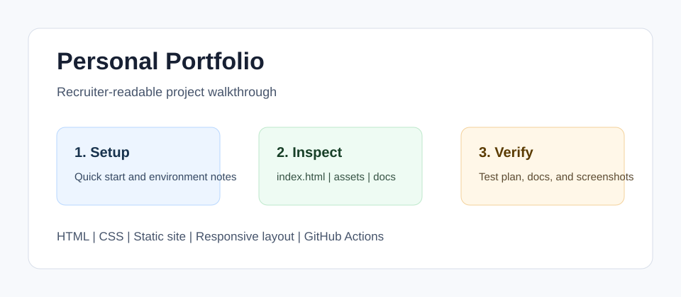

<!-- bettergithub:generated-readme -->
# Personal Portfolio

Personal Portfolio is a static website that presents Ammar Mawassi's projects, screenshots, and engineering interests in a recruiter-friendly format. It helps reviewers move from a GitHub profile to concrete proof points by linking portfolio sections to project images, implementation notes, and the repos that demonstrate web, AI, Java, and systems work.

## Tech Stack

- HTML
- CSS
- Static site
- Responsive layout
- GitHub Actions

## Quick Start

```bash
Open index.html in a browser.
Use a local static server if browser security blocks asset loading.
Review assets/ for project screenshots used by the page.
```

## Usage

- Open the portfolio landing page.
- Check each project card against its linked repo or asset.
- Use the docs as the reviewer map for updating screenshots and project copy.

## Environment Variables

No .env file, API key, package install, or backend service is required.

## Demo and Screenshots



The diagram above is a lightweight walkthrough image for GitHub reviewers. It shows the reviewer path, the implementation areas to inspect, and the evidence this repository provides. For non-web course projects, this replaces a live demo with reproducible local setup and manual verification notes.

## Testing and Quality

Testing is documented even when the original assignment uses manual verification instead of a full automated suite.

```bash
Manual test: open index.html, verify images load, and check links at desktop and mobile widths.
```

See [docs/test-plan.md](docs/test-plan.md) for the manual or automated checks that should be used before presenting this repository.

## Repository Structure

- `index.html`
- `assets`
- `docs`

## Architecture Notes

This is a static portfolio: one HTML entry point, local image assets, and documentation that explains how project evidence should be maintained.

See [docs/architecture.md](docs/architecture.md) for a more detailed reviewer map.

## Recruiter Notes

- The README opens with the project purpose, audience, and result so the repository is scannable.
- Setup, environment, usage, testing, and architecture notes are collected in predictable sections.
- Existing source code was not changed by the documentation polish pass.

## Roadmap

- Add a short result screenshot or terminal capture after the project is rerun locally.
- Add one small automated smoke test if the course/tooling environment makes it practical.
- Keep the README aligned with the latest verified run command.

## Existing Project Notes

# Ammar Mawassi Portfolio

Personal GitHub Pages portfolio for Ammar Mawassi.

## Highlights

- Static HTML/CSS/JS site with no build step.
- Clean modern layout with scroll reveals, hover motion, and responsive sections.
- Career-safe content based on Ammar's public software-engineering profile.
- Designed for `https://ammar31mawassi.github.io/`.

## Local Preview

```powershell
python -m http.server 4177 --bind 127.0.0.1
```

Then open `http://127.0.0.1:4177/`.


## GitHub synchronization and deployment

GitHub Pages is deployed by `.github/workflows/deploy.yml` on pushes to `main`,
manual workflow runs, and an hourly schedule at minute 17 UTC. GitHub may delay
scheduled runs and disable schedules in public repositories after 60 days without
repository activity; re-enable the workflow in Actions if that happens.

The build fetches public GitHub repository descriptions, languages, canonical
repository links, and last-push timestamps. The page keeps the hand-picked project
order and detailed case studies; it also shows the three most recently pushed
public projects. It excludes forks, archived repositories, the profile README,
and this portfolio from the recent-activity section.

To change featured projects, edit the cards in `index.html` and the curated names
in `projects.json`. Biography, project screenshots, teaching experience, and
case-study details are editorial content and are not rewritten from GitHub.

Local preview with synchronized data:

```powershell
python scripts/build.py
python -m http.server 4178 --directory _site --bind 127.0.0.1
```

`GITHUB_TOKEN` is optional locally and used only in the build process for API
requests. The published snapshot contains a selected set of public repository
fields, and visitors fetch it from this site rather than calling GitHub's API.
A failed data build prevents deployment, preserving the previous working site.
The static project cards remain usable if the snapshot cannot load in a browser.

Committing to another repository does not directly trigger this repository's
workflow. The hourly refresh picks those changes up; use **Actions → Sync GitHub
and deploy portfolio → Run workflow** for an immediate refresh.
